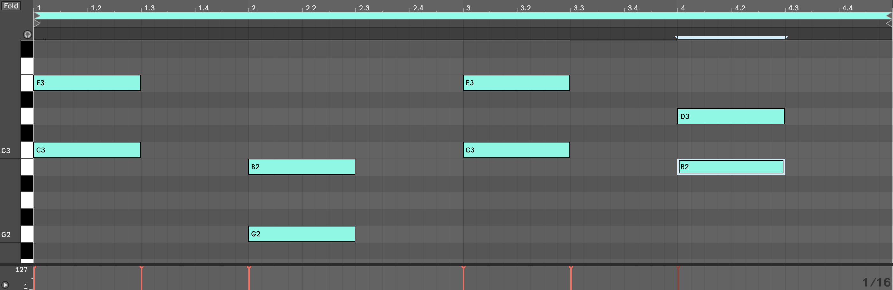
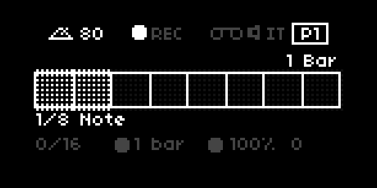
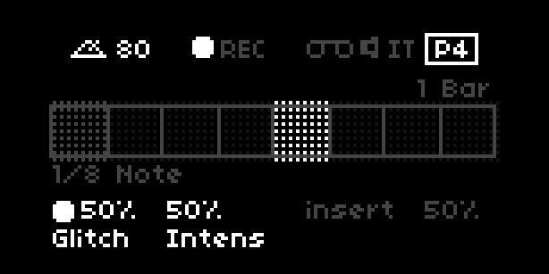
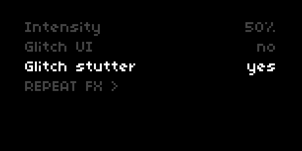
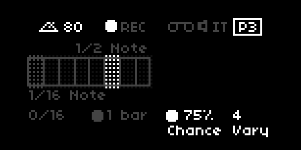
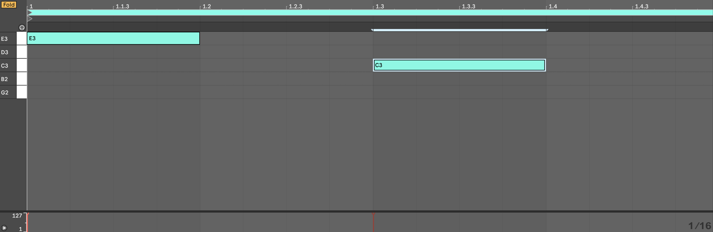
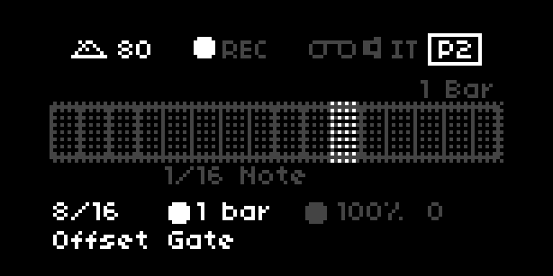

# B-B-B-B-Beat Guide
---

v0.11.0

## Introduction

The Beat Repeat plugin from Ableton is notoriously confusing. This guide is a humble attempt to demistify functionality and clarify expectations. From the [Ableton Manual](https://www.ableton.com/en/manual/live-audio-effect-reference/#22-4-beat-repeat) they describe Beat Repeat as such: "*Beat Repeat allows for the creation of controlled or randomized repetitions of an incoming signal.*" 

### Differences Norns v. Ableton

For this Norns port, there are differences from the Ableton version. It's important to note I am reverse engineering this based on experience and observation, so functionality is as 1:1 as I can get. Also, the glitching params are not present in the Ableton version.

### Parameters

**UI params**

These params are visible on the display of Norns and can be directly adjusted using the UI and knobs.

| Page | Param | Description | Values |
| ---- | ---- | ------------------------------------------------------------ | ---- |
| `P0` | `Tempo` | This can be set either manually or synced to sources as defined within Norns [`CLOCK` menu](https://monome.org/docs/norns/clocks/#parameters). On Fates it's always set with `E4`. | 1 – 300 |
| `P1` | `Interval` | This controls how often new material is captured and starts “repeating” it. This is always synced to the song’s tempo. | 1/256 notes – 4 bars |
| `P1` | `Grid` | This controls the size of each repeated slice. Large grid values create rhythmic loops, and small values create sonic artifacts. | 1/256 notes – 4 bars |
| `P2` | `Offset` | This shifts the record starting point, defined by given interval (1/16th notes). For example, if the interval is set to “1 bar” and offset is set to 8/16, the material will be captured for repetition once per bar on the third beat (in other words, halfway through the bar, or eight-sixteenths of the way). | 0/16 notes – 15/16 notes |
| `P2` | `Gate` | The total length of repetitions, counted from the capture at `Offset` and including it. For example, with `Gate` at 4/16 repeats play for one beat after each capture, then stop until the next. The dotted area of the bar shows the gate; the dot next to `Gate` is filled while inside it. | 1/16 – 15/16, 1 – 4 bars (default 4 bars) |
| `P3` | `Chance` | The likelihood of a repeat on each grid step within the gate. When a repeat fires, the captured slice restarts; when it doesn't, repeats are silent. At 100 percent every step repeats; at zero there are no repetitions. | 0 – 100% |
| `P3` | `Variation` | The likelihood (10% per step of Variation) that a grid step plays a shorter loop, so the repeat stutters faster within that step. Higher values also allow shorter loops: 1–3 halves the grid, 4–6 up to a quarter, 7–9 up to an eighth, 10 up to a sixteenth. At zero the grid size is fixed. | 0 – 10 |
| `P4` | `Glitch` | How often glitches happen: the chance on each clock tick (1/256 bar) that repeats jump to a random point, and on each grid step that `Glitch stutter` mutes them. | 0 – 100% |
| `P4` | `Intensity` | How strong glitches are: the chance a glitch also changes speed (held until the next grid step), how far (up to 3 octaves faster or slower at 100%) and how often it plays backwards (up to 50%). Also sets how far the UI shakes. At 0% glitches only jump. | 0 – 100% (default 50%) |
| `P5` | `Output` | When the dry input is heard (Beat Repeat's modes). `Mix` always passes the input with repeats on top, `Insert` mutes the input while repeats play, `Gate` only plays repeats. Shown on screen next to the speaker icon as `MX`, `IT` or `GE`. | `mix`, `insert` or `gate` (default `insert`) |
| `P5` | `Mix` | Balance of dry input and repeats. At 50% both are at full level; lower values fade the repeats, higher values fade the dry input. | 0 – 100% |
| `P6` | `Mode` | `Live` mode uses live audio input and `Sample` mode uses a chosen sample file, loaded with `K3` on this page or via the params menu. | `Live` or `Sample` |
| `P6` | `Input` | `Stereo` records inputs 1 and 2 to the left and right repeats. `Mono` records input 1 to both. | `Stereo` or `Mono` |

`K3` on `P3` sets `Chance` to 0% while held, on `P4` it sets `Glitch` to 100% while held.

**Hidden params**

These params are only listed within params menu.

| Param     | Description                                                             | Values |
| ---- | ------------------------------------------------------------ | ---- |
|  `Glitch UI` | Toggle the glitching of the UI whenever a glitch is heard; it happens more often as `Glitch` rises and more “violently” as `Intensity` rises | `yes` or `no` (default `yes`) |
|  `Glitch stutter` | Toggle an audio stutter (e.g. random muting of repeats) the likelihood of stutter occuring increases based on the `Glitch` param. | `yes` or `no` |

### Repeat FX

Pitch, volume and filter shape the repeats (Softcut playback), like Beat Repeat's `Pitch`, `Volume`/`Decay` and `Filter` controls. Each has a page for its two main values followed by a page for its LFO (`E2` LFO rate, `E3` LFO depth). The dot next to `Freq` shows if the filter is on, the dot next to `Rate` blinks with the LFO.

| Page | Param | Description | Values |
| ---- | ---- | ------------------------------------------------------------ | ---- |
| `P7` | `Pitch` | Pitch of repeats. Recording always happens at normal speed, so captured audio isn't warped. | -24 – +24 semitones |
| `P7` | `Pitch decay` | Semitones added to pitch on each repeat; negative values make repeats fall in pitch (Beat Repeat's `Pitch Decay`). Resets on each new capture. | -12 – +12 semitones |
| `P9` | `Volume` | Level of repeats. | 0 – 100% |
| `P9` | `Volume decay` | Level lost on each repeat, repeats fade out (Beat Repeat's `Decay`). Resets on each new capture. | 0 – 100% |
| `P11` | `Filter freq` | Center frequency of the band-pass filter. | 20 Hz – 20 kHz |
| `P11` | `Filter width` | Width of the band-pass filter, narrow (resonant) to wide. | 1 – 100% |
| | `Filter` | Turns the band-pass filter on or off (params menu only). | `off` or `on` (default `off`) |

**Modulation**

Every FX param has an LFO, with rate and depth on the page after its FX (`P8`, `P10`, `P12`). Shape is set within the `REPEAT FX` params group.

| Param | Description | Values |
| ---- | ------------------------------------------------------------ | ---- |
| `LFO rate` | Length of one LFO cycle, synced to tempo. | 1/256 notes – 4 bars |
| `LFO shape` | `sine`, `triangle`, `saw` and `square` move smoothly/regularly; `s&h` jumps to a new random value each cycle; `rand/rpt` jumps to a new random value on **each repeat** (ignores rate). | |
| `LFO depth` | Amount of modulation: semitones for pitch, % of volume (tremolo), octaves for filter frequency. `0` turns the LFO off. | pitch 0 – 24 st, volume 0 – 100%, filter 0 – 4 oct |

### Modes

B-B-B-B-Beat supports both live audio and loading of samples. Changing modes can be on screen within page 6 (`P6`) using encoder 2 `E2` to change or within the params menu.

| Live mode | Sample mode |
| ---- | ----------- |
|   This icon indicates that live audio mode is active and when and how long recording of material takes place is determined by `Interval`, `Grid`, and `Offset` params. |  This icon indicates that sample mode is active. Samples can be loaded via the params menu or when on page 6 (`P6`) by pressing key 3 (K3). |
| |  If a sample is loaded, a rectangle is drawn around the icon.  |

### Midi

All of the above listed params can also be controled with Midi CC via `MAP` within params menu. See Norns [documentation on mapping](https://monome.org/docs/norns/play/#map) for more details.

If you're using any clock sync method (except for `MIDI`) you will have to manually sync to the first beat by pressing `K2`. If you're using `MIDI` sync, B-B-B-B-Beat will automatically sync to the 1st beat whenever a Midi `start` or Midi `stop` command is sent. 

*Note: Norns is a USB Midi host and your computer (i.e. Ableton, etc.) is a USB Midi host. In order sync two Midi hosts you need a special connector, see [this discussion](https://llllllll.co/t/how-to-sync-two-usb-midi-hosts/15893) for details and solutions.*

---

## Examples

The following examples are crafted to help you understand (hopefully) and get started with B-B-B-B-Beat. Use these as a starting point. This script is great for experimentation and I would encourage you to do so. Audio source doesn't matter, I personally use this for live audio, but any of the following can be used with samples as well, just be sure to use the appropriate `Mode `.

For the following examples, I've created 4 bars of 1/2 notes as live audio (in Ableton). 

### Example 1: Basic Repeat

We'll configure Beat Repeat to record material once per bar and repeat the input every eighth note. These notes will be repeated from the first beat of the given pattern with no offset. 

| Param     | Value     |
| --------- | --------- |
| `Interval` | 1 Bar |
| `Grid` | 1/8 Note |
| `Offset` | 0/16 |
| `Gate` | 1 bar |
| `Chance` | 100% |
| `Variation` | 0 |
| `Glitch` | 0% |
| `Output` | `insert` |

Using the above audio input, each chord will repeat on the eigthth note. Adjusting the `Grid` param to increase the frequency of the repeats, by the given note value.  

### Example 2: Glitch Stutter

Using the same configuration as above, we'll add some intermitent glitching and stuttering. Set `Glitch` to 50% and enable `Glitch stutter`. This will mangle the audio e.g. randomly change [softcut rate](https://monome.org/norns/modules/softcut.html#rate) and mute audio. 

and in the params menu, be sure to set `Glitch stutter` to `yes`

| Param     | Value     |
| --------- | --------- |
| `Interval` | 1 Bar |
| `Grid` | 1/8 Note |
| `Offset` | 0/16 |
| `Gate` | 1 bar |
| `Chance` | 100% |
| `Variation` | 0 |
| `Glitch` | 50% |
| `Intensity` | 50% |
| `Glitch stutter` | yes |
| `Output` | `insert` |

Adjusting the `Glitch` param will change how often glitch and stutter effects happen, `Intensity` how wild the speed changes get. To just  mangle audio without stutter disable `Glitch stutter`.

### Example 3: Glitchy Madness

We'll build off of the above and add even more glitch effect. By reducing the `Interval` to 1/2 notes the record trigger will happen more frequently and the `Grid` at 1/16 note will net 8 repeats per loop. Decreasing `Chance` to 75% means that 25% of the time, no repeats will happen and the original unaffected material will be heard. (Still with me?). Lastly we'll increase `Glitch` to 75%, but disable `Glitch stutter`.

| Param     | Value     |
| --------- | --------- |
| `Interval` | 1/2 Note |
| `Grid` | 1/16 Note |
| `Offset` | 0/16 |
| `Gate` | 1 bar |
| `Chance` | 75% |
| `Variation` | 4 |
| `Glitch` | 75% |
| `Intensity` | 75% |
| `Glitch stutter` | no |
| `Output` | `insert` |

### Example 4: Offset  

For the offset example, I'm using 1 bar of 1/4 notes because it's easier to understand how the offset param works.

We'll configure the repeater to loop once per bar and repeat the recorded material every 16th note. However, we're going to tell it to record audio starting half way through the bar (hence the `Offset` setting of 8/16). With the above audio example, that means only the C3 note will be repeated. 

*Note: This example assumes you are syncing the 1st beat of B-B-B-B-Beat to 1st beat of the incoming audio. [See above](#midi) for details on syncing.*

| Param     | Value     |
| --------- | --------- |
| `Interval` | 1 Bar |
| `Grid` | 1/16 Note |
| `Offset` | 8/16 |
| `Gate` | 1 bar |
| `Chance` | 100% |
| `Variation` | 0 |
| `Glitch` | 0% |
| `Output` | `insert` |

Adjusting the `Offset` param to change the recording trigger position.

### Example 5: Clear Stutter

A classic stutter fill: once per bar, the 16th note on beat 4 is captured and repeated for the rest of that beat. `Gate` at 4/16 stops the repeats after one beat, so the other three beats pass through untouched. With no glitch or variation every repeat is an exact copy, on the grid.

This is saved as the `clear stutter` PSET (slot 2) in `PARAMETERS > PSET`.

| Param     | Value     |
| --------- | --------- |
| `Interval` | 1 Bar |
| `Grid` | 1/16 Note |
| `Offset` | 12/16 |
| `Gate` | 4/16 |
| `Chance` | 100% |
| `Variation` | 0 |
| `Glitch` | 0% |
| `Output` | `insert` |
| `Mix` | 50% |

For a faster roll set `Grid` to 1/32; for a stutter on every beat set `Interval` to 1/4 Note and `Gate` to its maximum. Adding `Volume decay` (`P9`) fades the repeats out, `Pitch decay` (`P7`) makes them rise or fall.

---

## Additional references

- [How to use the Ableton Live BEAT REPEAT audio effect](https://obedia.com/how-to-use-the-ableton-live-beat-repeat-audio-effect/)
- [Guide to Beat Repeat from Quantize Courses](https://www.ableton.com/en/blog/guide-beat-repeat-quantize-courses/)
- [22. Live Audio Effect Reference 22.4 Beat Repeat](https://www.ableton.com/en/manual/live-audio-effect-reference/#22-4-beat-repeat)

