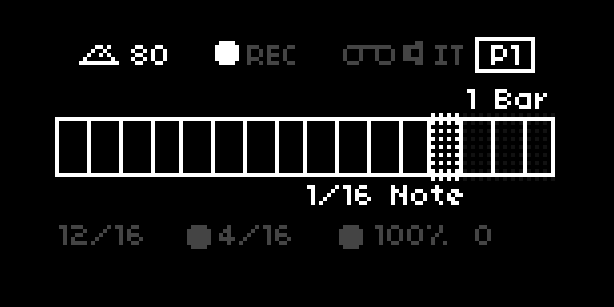

B-B-B-B-Beat
---

v0.10.0

A repeater inspired by [Ableton's Beat Repeat](https://www.ableton.com/en/blog/guide-beat-repeat-quantize-courses/) for [Norns](https://monome.org/norns), with some added glitchy inspiration from [MASF Possessed](https://www.youtube.com/results?search_query=masf+possessed)/[MWFX Judder](https://www.youtube.com/results?search_query=mwfx+judder).

This script uses live audio or samples for all of its repeating magic! Read more about the different modes in the [guide](./GUIDE.md#modes).




## Demo

I'll post a brief demo showing B-B-B-B-Beat in action, soon.


## Requirements

[Norns](https://monome.org/norns) or [Fates](https://llllllll.co/t/fates-a-diy-norns-dac-board-for-raspberry-pi/22999) or device running a recent norns release (uses `clock.tempo_change_handler`). For Fates owners, BPM value can be persistently controlled using the 4th encoder, for Norns owners it's `E2` the first page `P0`. BPM adjusts the system clock tempo directly (`PARAMETERS > CLOCK`).


## Install/Update

B-B-B-B-Beat can be installed via [Maiden's](https://norns.local/maiden) project manager.


## Params

Params be controled with Midi CC via `MAP` within params menu. For a detailed overview of the params and general functionality of this script refer to the [guide](./GUIDE.md).

| Page    | Controller                    | Description                               | Values                         |
| ------- | ----------------------------- | ----------------------------------------- | ------------------------------ |
| All     | E1                            | Change page                               |                                |
| All     | K2                            | Resync to beat 1                          |                                |
|         |                               |                                           |                                |
| 0       | E2 or E4                      | BPM                                       | 1 - 300                        |
|         |                               |                                           |                                |
| 1       | E2                            | Interval length                           | 1/256 - 4                      |
| 1       | E2                            | Grid length                               | 1/256 - 4                      |
|         |                               |                                           |                                |
| 2       | E2                            | Offset amount                             | 0/16 - 15/16                   |
| 2       | E3                            | % repeat occurrence (chance)              | 0 - 100%                       |
| 2       | K3                            | toggle chance (temp. set 0%)              | 0%                             |
|         |                               |                                           |                                |
| 3       | E2                            | amount of Grid variance                   | 0 - 10                         |
| 3       | E3                            | % glitch occurrence                       | 0 - 100%                       |
| 3       | K3                            | toggle glitch effect (temp. set 100%)     | 100%                           |
|         |                               |                                           |                                |
| 4       | E2                            | change mode `live` or `sample`            | `live` or `sample`             |
| 4       | K3                            | load new sample                           | Any valid audio file           |
|         |                               |                                           |                                |
| 5       | E2                            | pitch of repeats                          | -24 - +24 semitones            |
| 5       | E3                            | pitch decay per repeat                    | -12 - +12 semitones            |
| 6       | E2                            | volume of repeats                         | 0 - 100%                       |
| 6       | E3                            | volume decay per repeat                   | 0 - 100%                       |
| 7       | E2                            | band-pass filter frequency                | 20 Hz - 20 kHz                 |
| 7       | E3                            | band-pass filter width                    | 1 - 100%                       |
| 5 - 7   | K3 (hold) + E2                | LFO rate                                  | 1/256 - 4                      |
| 5 - 7   | K3 (hold) + E3                | LFO depth                                 |                                |


## Development

[SSH](https://monome.org/docs/norns/maiden/#ssh) into your Norns/Fates, then enter the following commands in terminal.

```bash
$ cd dust/code
$ git clone https://github.com/frederickk/b-b-b-b-beat.git
```

If you want to get the latest version run these commands:

```bash
$ cd dust/code/b-b-b-b-beat
$ git fetch origin
$ git checkout primary
$ git merge origin/primary
```


## Changelog
- v0.10.x
    - Added repeat FX: pitch (+/-24 st), volume and band-pass filter (pages `P5` - `P7`)
    - Added pitch decay and volume decay per repeat
    - Added tempo-synced LFO per FX (sine, triangle, saw, square, s&h, random per repeat); hold `K3` to edit
- v0.9.x
    - Updated for latest norns firmware
        - BPM controls system `clock_tempo` directly; script no longer resets tempo on load
        - Loop length follows tempo changes from any clock source (`clock.tempo_change_handler`)
        - System mixer levels (input, softcut, reverb send) restored when script exits
        - Stutter mutes softcut voices instead of global softcut level
        - PSETs written to last used slot instead of always overwriting slot 1
        - Named param separators/group IDs
    - Fixed screen smearing when `Glitch UI` is off; `Glitch UI` now off by default
    - Fixed crash when releasing K2 (or K3 on pages without a K3 action)
    - Fixed mono sample loading and sample length for non-48kHz files
    - K3 sample selection now updates (and saves) the `Audio file` param
    - Removed leaked globals (incl. a stray global `init` in `lib/core/ui.lua`)
    - Added sample loading
    - Toggle live/sample mode in UI
    - Tweaked glitch effect
    - Fixed 'core' appearing in Norns list
    - Created GUIDE.md
    - Change K3 function to toggle params
- v0.8.x
    - Separated clock and redraw coroutines (https://llllllll.co/t/norns-clock/30738/77) 
    - Fixed passthrough bug when chance below 100% 🤞
- v0.7.x
    - Added offset param
    - Updated UI; more detail
    - Removed SC engine, restart no longer required on install
    - Addressed repeat (tempo/softcut) bugs
    - Updated README.md with more detail
- v0.6.x
    - Refactored codebase 
- v0.5.x
    - Fixed Glitch engine
    - Added param to toggle glitch noise (hiss)
    - Added param to toggle UI glitch
    - Added param to toggle stutter
    - Added to Maiden
- v0.4.x
    - Fixed params bug; params:add_option
    - Fixed "Chance" param; default 100%
    - Added Midi passthrough
    - Enabled param reading/writing
- v0.3.x Initial release
